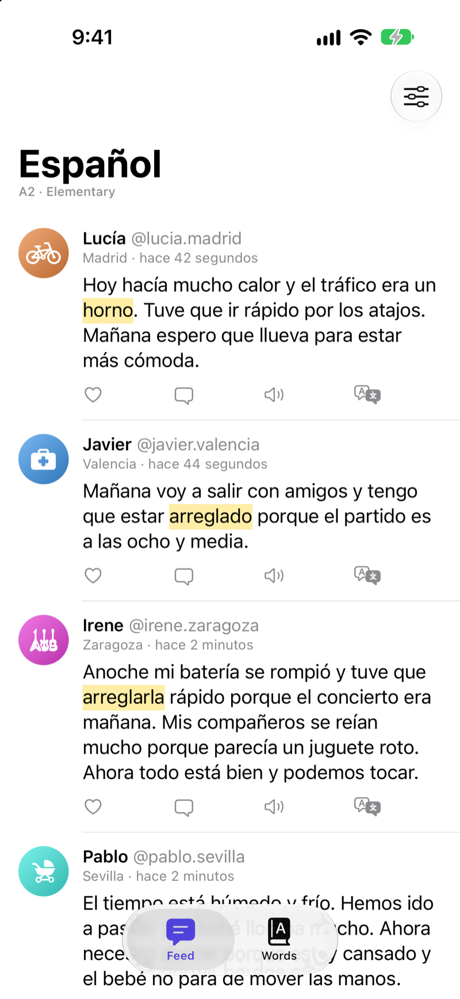
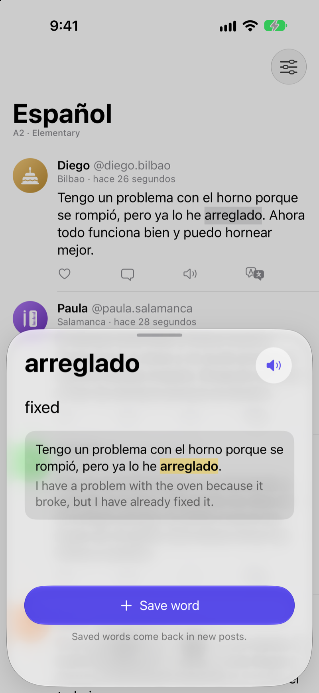
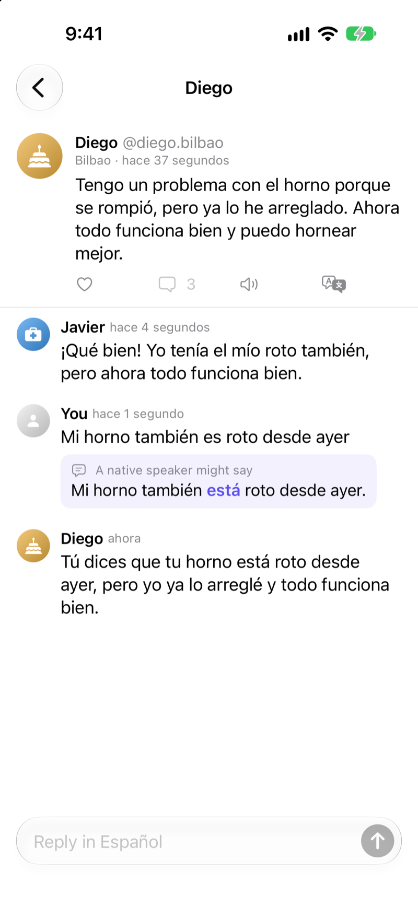
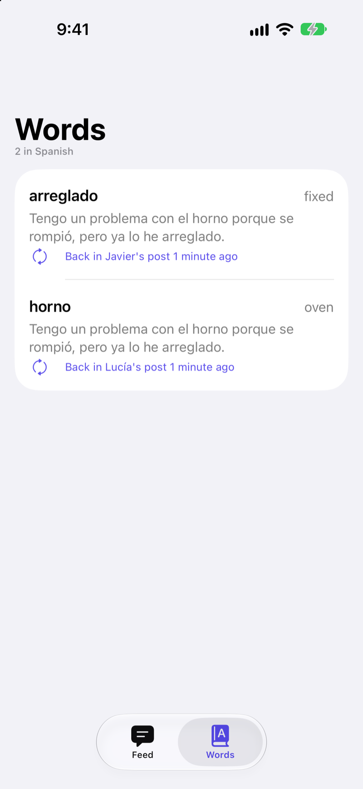
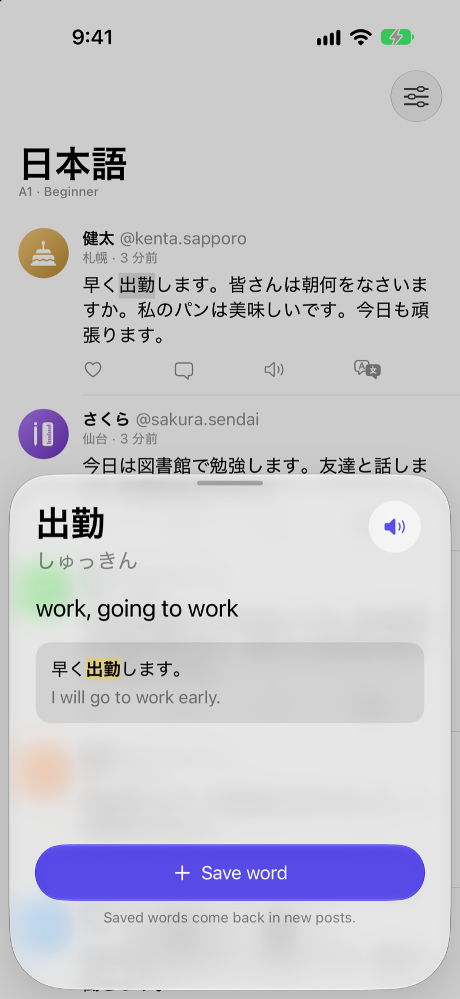

# Immerse


A social feed in the language you're learning. Everyone in it is written by Apple's on-device model, at your level:
a nurse on night shifts in Valencia, a bike courier in Madrid, a baker in Bilbao who starts work at four. Tap any word
to see what it means in that sentence. Reply to anyone and they answer. Save a word and the people in your feed start
using it.

Nothing leaves the iPhone. Every post, reply, meaning and suggestion comes from the Foundation Models framework, so
there's no server, no account and no API key.

<table>
  <tr>
    <td></td>
    <td></td>
    <td></td>
    <td></td>
    <td></td>
  </tr>
  <tr>
    <td>Saved words come back, highlighted</td>
    <td>What a word means in its sentence</td>
    <td>Replies, and how a native speaker might say yours</td>
    <td>Every word you saved, and where it came back</td>
    <td>Readings for Japanese, Chinese and Korean</td>
  </tr>
</table>

## What's here

| | |
|---|---|
| [`Sources/ImmerseKit`](Sources/ImmerseKit) | The feed: the cast, levels, topics, prompts, the engine that writes and checks every post, word lookup with NaturalLanguage, and the saved-word loop. Everything that talks to the model goes through one `Writer` protocol, so the tests run it from a script. |
| [`App`](App) | The SwiftUI app for iPhone (iOS 26): the feed, threads, the word sheet, saved words, and the screen you see on a phone without Apple Intelligence. |
| [`Tests`](Tests/ImmerseKitTests) | 45 Swift Testing tests. Most use a scripted writer. The live ones run against the real on-device model and skip themselves on machines without it. |

## How it works

**The cast is written by hand.** Each language has the same eight lives, lived by people with local names in local
cities: Javier is a nurse in Valencia, 悠斗 is one in Osaka, Lukas in Köln. The prompts describe each life in the
second person, so they never need a pronoun, and give the speaker's gender, because Spanish, French, Italian and
Portuguese agree adjectives with it. Asked to invent the people itself, the model gave one-line lives ("Carlos
studies at university and likes to travel") and handles that were just first names.

**Levels name the grammar, not just the level.** "Write at A2" on its own gets the same post the model would have
written anyway, so each level lists the tenses, sentence length and vocabulary it allows. Japanese and Korean at A1
and A2 are told to use the polite forms courses teach first.

**Each post comes from a new session.** Sessions are cheap and a post needs nothing from the last one, but a session
can't see the feed, so left alone four posts in five opened with *Hoy*, "today". Each prompt now names the words the
last three posts started with, and gets a topic from a deck that doesn't repeat for the same person.

**Every post is checked.** `NLLanguageRecognizer`, limited to the target language and English, catches the posts that
drift into English or end with a translation. Those are written again, up to three times, and so are the ones where
the model hits its token limit or a guardrail.

**Then it's rewritten the way a native speaker would write it.** The model's grammar is good but not perfect. While
building this it wrote *la comida era muy sabroso*, *meinen Brot*, and Irene, a woman, wrote *estuve ocupado*. A
second pass rewrites each post the way a native speaker would, told who's speaking, and fixed all of those. A rewrite
is kept only if it's still in the right language, isn't much shorter, and still uses the saved word the post was meant
to bring back.

**Your comments get the same rewrite.** If yours changes, a quiet box underneath shows how a native speaker might say
it, with the changed words picked out. On 16 test comments it fixed all 8 with a real mistake (*es roto* → *está
roto*, *j'ai allé* → *je suis allé*) and left 7 of the 8 correct ones alone. The eighth came back reworded for
style (*es muy rico* → *está muy rico*), which is why the box says "might". The model also has a field for whether
there was a mistake at all. It answered no for all 8 mistakes, even while fixing them, so the app goes by whether the
words changed.

**Replies answer what you meant.** The author replies the way friends do in conversation: by repeating what you said
before adding their own news. Echoing a mistake would teach it, so the reply prompt gets your comment as the native
speaker would have said it.

**Tapping a word.** Each word is a link inside one `AttributedString`, and the `openURL` action opens the word
sheet. It stays one `Text`, so it wraps, scales with Dynamic Type and lays out Japanese and Chinese the way the
system does. NaturalLanguage splits the words, including in Japanese and Chinese, which don't use spaces, and gives
dictionary forms where it knows them. Readings come from `CFStringTokenizer`'s transcription, turned into hiragana
for Japanese, and from ICU's transforms for pinyin and Korean.

**A word's meaning depends on its sentence.** The sheet asks the model to translate the sentence first, then pick out
the words in that translation that stand for the tapped word. Asked for the word's meaning first, it handed Japanese,
Korean and Chinese words back untranslated. Whole posts go through the Translation framework.

**Saved words come back.** Once two posts have gone by without a saved word, the next post is asked to use the one
seen least, in whatever form the sentence needs. A saved word counts as seen in any form: by dictionary form where
NaturalLanguage knows it, and by sharing all but the last three letters where it doesn't, so *arreglado* is seen in
*arreglarla* but *casa* isn't *caso*.

**The writing belongs to the model, not the screen.** Posts are written in a task the app model owns, so switching
tabs while the feed fills doesn't cancel it halfway.

## What the model gets wrong

Apple's on-device model is small, and it shows:

- **Grammar.** The rewrite pass fixed every slip found while building this, but there will be ones it misses.
- **Sense.** Now and then a post doesn't make sense: *El perro de al lado tiró la cadena del tendedero y cayó el
  espinazo* ("the dog next door pulled the clothesline chain and the spine fell"). The feed screenshot above is real
  output, with that one post removed from the top.
- **Saved words in odd places.** Told to use *caliente*, one post said a song "sounds very hot". The prompt now asks
  for the everyday meaning.
- **Replies.** They sometimes miss the point of your comment.
- **Japanese at A1.** Posts are very short and sometimes don't hang together.

## Requirements

- An iPhone with Apple Intelligence (iPhone 15 Pro or later) on iOS 26, and Xcode 26.
- The languages offered are the ones the on-device model writes: Spanish, French, German, Italian, Brazilian
  Portuguese, Japanese, Korean, Chinese, Dutch, Turkish and Vietnamese, each checked on the device at launch.
- The simulator works when the Mac has Apple Intelligence turned on. The Translation framework doesn't run in the
  simulator, so there the model translates whole posts too.

## Building

```sh
swift test                         # the package, including the live tests where the model is available
open App/Immerse.xcodeproj       # the app
```

Debug builds take launch arguments that walk the app to each screen (`-demo-language es -demo-level a2`,
`-demo-word 3`, `-demo-thread -demo-reply "…"`). They're how the screenshots were taken; see
[`Demo.swift`](App/Immerse/Demo.swift).

## License

MIT
